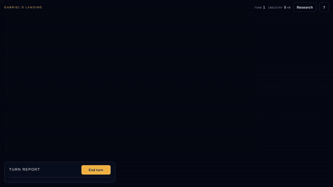

# Gabriel's Landing

A small turn-based space 4X in the browser, rendered with three.js.
Explore a fogged, three-dimensional star cluster, split and merge fleets, settle colonies,
research, and out-fight up to six scripted rivals.



## Play

**Play it in your browser: https://romilly.github.io/four-x-web/**

New players are offered a short tutorial on their first visit. You can also open `index.html` from a copy of
this repository; it loads three.js and js-yaml from CDNs, so it needs a connection.

- Touch: drag to pan, pinch to zoom, drag with two fingers to rotate.
- Mouse: drag to pan, scroll to zoom, right-drag or Shift-drag to rotate.

Visits to the game page are counted by [GoatCounter](https://www.goatcounter.com/), which uses no cookies;
the dashboard is at https://romilly.goatcounter.com. The tests block outside requests, so they are never counted.

## New games

Under **?** → Game, choose a galaxy size and a victory condition, then tap a difficulty to start.

| Difficulty | Rivals |
|---|---|
| Easy | Fog of war like yours; attack late; earn 75% of what you would |
| Normal | Your equals: fog of war like yours, the same income |
| Hard | As Normal, but they see the whole map |
| Impossible | See the whole map, attack early, put 80% of their spare IU into fighters, earn 125% |

| Size | Stars | Empires |
|---|---|---|
| Small | 28 | 3 |
| Medium | 48 | 5 |
| Large | 72 | 7 |

- **Total victory:** be the last empire standing.
- **Dominance:** hold 60% of all habitable planets, or be the last standing. A rival that reaches 60% first wins.

## Saved games

Open the **?** panel and choose **Save as YAML** or **Load a save**. A save is a readable YAML file
with a `format` name and a `version` (the save-format version, currently 2; version-1 saves load as small galaxies). The game refuses files that are not
saves, saves from a newer version, older formats it cannot migrate, and damaged files, and says why.
Inside Claude the file is offered as `.yaml.txt`, because Claude only allows some download types;
the contents are the same.

When the shape of the game state changes, bump `SAVE_VERSION` in `core.js` and, if possible, add a
migration from the previous version to `MIGRATIONS`.

## Versions

The game uses semantic versioning; see [CHANGELOG.md](CHANGELOG.md). The version shows in the page header
(on phones, in the ? panel and at the foot of the orders panel), so a screenshot tells you which version
someone is running. To release: update `GAME_VERSION` in `core.js`, `version` in `package.json` and add a
CHANGELOG entry (a test checks all three agree), then tag the commit, e.g. `git tag v1.1.0`.

## Layout

- `core.js` — the pure game core (including `toSave` / `fromSave`): plain data in, plain data out, no DOM, no clock.
  `newGame(seed, difficulty, size, victory)`, `resolveTurn(state, orders, rng)`, `aiOrders(view, empire, rng)`,
  `fogView(state, empire)` and friends.
- `index.html` — the three.js renderer and the interface, an adapter over the core.
- `test/` — tests for the core.
- `e2e/` — browser tests (Playwright), with `serve.js` serving the game locally.
- `demo/` — the demo recorder and the link-preview picture maker.
- `sim/` — balance simulations (`balance.js`) and their Python wrapper (`balance.py`).

## Test

```
npm install
npm test          # the game core: rules, saves, galaxy sizes (node:test)
npm run e2e       # the game in a real browser, desktop and phone sizes (Playwright)
```

Needs Node 18 or later. For the browser tests, install Playwright's Chromium once with
`npx playwright install chromium`. The browser tests serve the game from this folder and answer its CDN
libraries from `node_modules`, so they need no web server and no network. Both suites run on every push
through GitHub Actions (`.github/workflows/test.yml`).

## Balance simulations

`sim/` plays many galaxies with a scripted stand-in on your side, to compare difficulty settings. The stand-in
is the rivals' own AI, playing with fog of war and Normal habits, so the results compare variants with each
other; they don't predict how a person will fare. Games are seeded, so the same settings always give the same
results. It needs only Node 18 or later (no `npm install`); the Python wrapper also needs pandas.

**From Python or Jupyter.** Start Python or Jupyter in this folder (or a folder below it), then either
`import sys; sys.path.insert(0, 'sim')` and `from balance import run_balance, summarise`, or paste the whole of
`sim/balance.py` into a notebook cell:

```python
df = run_balance({
    'Normal':     {'base': 'normal'},
    'Hard':       {'base': 'hard'},
    'Hard 110%':  {'base': 'hard', 'income': 1.1},
    'Impossible': {'base': 'impossible'},
}, size='small', galaxies=48, turns=200)
summarise(df)
```

- A variant is a base level (`easy`, `normal`, `hard` or `impossible`) plus any of its settings to override: `fog`
  (rivals' fog of war), `attackTurn` (earliest attack), `shipShare` (share of IU left after research and
  colony ships that goes on fighters) and `income` (rivals' income multiplier). See `DIFF` in `core.js`.
- `run_balance` returns one row per game: `variant`, `seed`, `size`, `result` (`win`, `loss` or
  `unfinished`), `end_turn`, `biggest_rival_fleet`, and at turns 30, 60 and 120 the stand-in's share of
  habitable planets (`share_60`), its income (`income_60`) and the best rival's (`best_rival_income_60`).
  These are empty once the game has ended or the stand-in has fallen.
- `galaxies` is the number of runs per variant: each run plays one galaxy to the end. The same call always
  gives the same results, because games are seeded; to reduce noise, use more galaxies (four times as many
  halves the standard error), or try other `seeds` to check a result holds on different galaxies.
- Other arguments: `seeds=[...]` to choose galaxies (default 1000, 1037, 1074, ...), `victory='dominance'`,
  and `repo='path/to/four-x-web'` if Python is running somewhere else.
- `summarise(df)` counts wins, losses and unfinished games per variant with the win rate and its standard
  error. Differences smaller than about two standard errors are likely to be chance: with 48 galaxies and a
  30% win rate, that is about 6 or 7 wins.
- Each variant runs in its own Node process, in parallel. Three variants of 48 small galaxies take about
  20 seconds; medium and large galaxies take longer.

**From the shell.** `node sim/balance.js sim/example.json` reads a spec (a file, or JSON on stdin) and
prints one JSON line per game; `sim/example.json` compares the four levels, and Hard with each of
Impossible's settings added in turn. The spec's fields are listed at the top of `sim/balance.js`.

**Tests.** `npm test` covers the simulator; `python -m pytest sim` checks the Python wrapper.

## Demo

```
npm run demo
```

Plays a scripted opening and a large galaxy in a recorded browser, writing `demo-output/gabriels-landing.webm`
(and an `.mp4` and `.gif` when `ffmpeg` is installed). `docs/demo.gif` at the top of this page was made this way.

## Link preview

When the game's link is pasted into a chat app, an email or a social site, it shows `docs/preview.jpg` with the
description from the `og:` tags at the top of `index.html`. After a visible change to the game, remake the picture:

```
npm run preview
```

It uses the game's own fonts from `node_modules`, so it needs no network.
